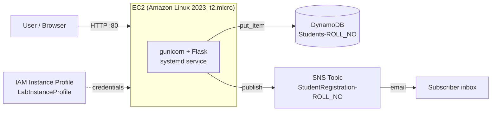
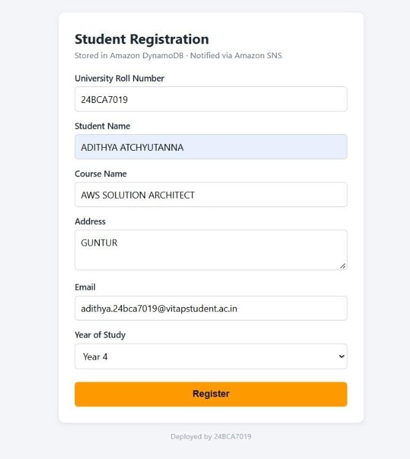
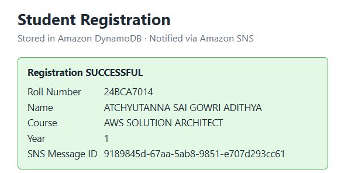
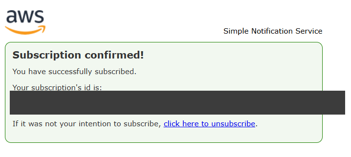
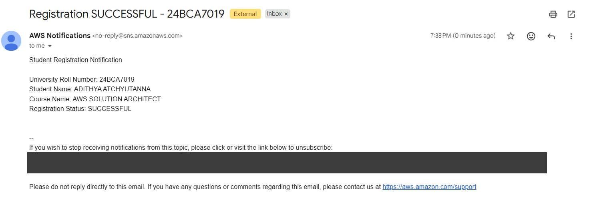
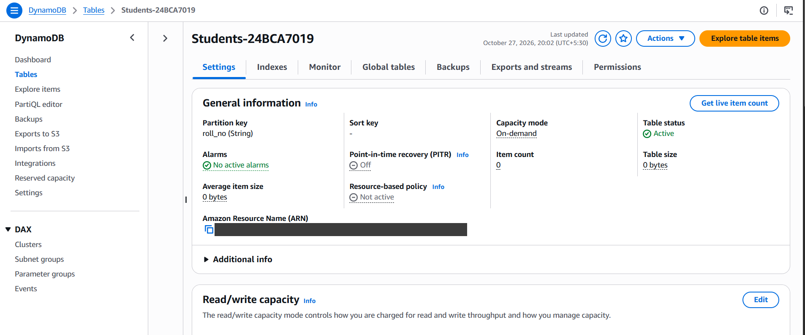
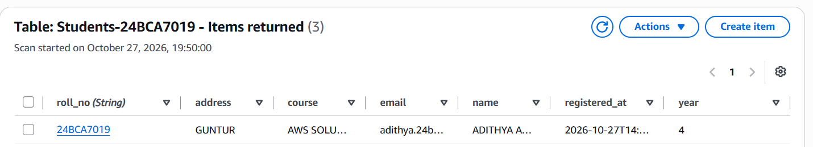
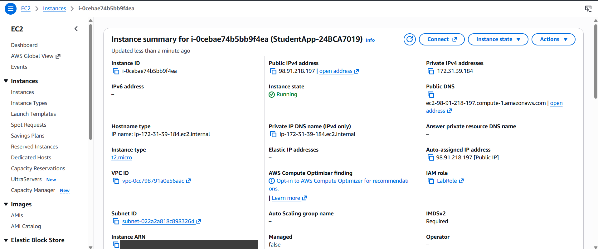
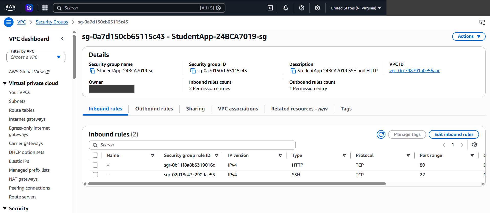
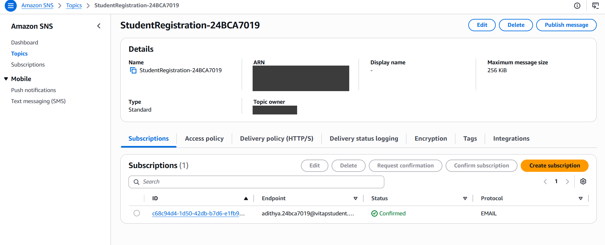

# AWS Student Registration Portal

A Flask web application deployed on **Amazon EC2** that registers students,
stores each record in **Amazon DynamoDB**, and sends a real-time email
notification through **Amazon SNS**. The app has no hard-coded AWS keys: it gets
credentials from the EC2 **IAM instance profile**.


---

## Architecture



**Request flow**
1. The student fills in the registration form (roll number, name, course, address, email, year).
2. Flask validates the input and writes the record to DynamoDB. A conditional
   write rejects duplicate roll numbers with a **409** response.
3. On success, the app publishes a message to the SNS topic.
4. SNS emails every confirmed subscriber with the roll number, name, course and registration status.

---

## Features

- Server-side validation (required fields, email format, year range 1–5)
- Duplicate-safe writes with a DynamoDB `ConditionExpression`
- Email notifications through SNS, with the message ID shown on the success page
- Credentials come only from the IAM role; no secrets in code
- Configured entirely by environment variables
- Production setup: gunicorn workers under systemd, automatic restart, starts on boot
- `/health` endpoint for monitoring

---

## Screenshots

| Registration form | Successful registration |
|---|---|
|  |  |

| SNS subscription confirmed | SNS email notification |
|---|---|
|  |  |

| DynamoDB table | DynamoDB items |
|---|---|
|  |  |

| EC2 instance | Security group rules |
|---|---|
|  |  |

**SNS topic with confirmed email subscription**



---

## Tech Stack

| Layer | Technology |
|---|---|
| Frontend | HTML5, CSS (Jinja2 templates) |
| Backend | Python, Flask, boto3 |
| App server | gunicorn, systemd |
| Compute | Amazon EC2 (Amazon Linux 2023) |
| Database | Amazon DynamoDB (on-demand) |
| Notifications | Amazon SNS (email) |
| Security | IAM instance profile, EC2 security group (ports 22, 80) |

---

## Project Structure

```
.
├── app.py               # Flask app: routes, validation, DynamoDB + SNS calls
├── templates/
│   └── index.html       # Registration form and result page
├── requirements.txt     # flask, boto3, gunicorn
└── docs/screenshots/    # Screenshots used in this README
```

---

## Configuration

| Variable        | Description                                  | Example |
|-----------------|----------------------------------------------|---------|
| `AWS_REGION`    | AWS region                                   | `us-east-1` |
| `ROLL_NO`       | Owner's roll number (shown in the page footer) | `24BCA7019` |
| `TABLE_NAME`    | DynamoDB table (partition key `roll_no`, String) | `Students-24BCA7019` |
| `SNS_TOPIC_ARN` | ARN of the SNS topic                         | `arn:aws:sns:us-east-1:<account-id>:StudentRegistration-24BCA7019` |

---

## Routes

| Method | Path        | Description |
|--------|-------------|-------------|
| GET    | `/`         | Registration form |
| POST   | `/register` | Save the student and send the SNS email (409 for a duplicate roll number) |
| GET    | `/health`   | Health check, returns `{"status": "ok"}` |

---

## Deployment (AWS CLI)

**1. SNS topic and email subscription**
```bash
aws sns create-topic --name StudentRegistration-<ROLL_NO>
aws sns subscribe --topic-arn <TOPIC_ARN> --protocol email \
    --notification-endpoint <your-email>
# Then confirm the subscription from the email AWS sends you
```

**2. DynamoDB table**
```bash
aws dynamodb create-table --table-name Students-<ROLL_NO> \
    --attribute-definitions AttributeName=roll_no,AttributeType=S \
    --key-schema AttributeName=roll_no,KeyType=HASH \
    --billing-mode PAY_PER_REQUEST
```

**3. Security group (SSH + HTTP)**
```bash
aws ec2 create-security-group --group-name StudentApp-<ROLL_NO>-sg \
    --description "SSH and HTTP" --vpc-id <default-vpc-id>
aws ec2 authorize-security-group-ingress --group-id <SG_ID> --protocol tcp --port 22 --cidr 0.0.0.0/0
aws ec2 authorize-security-group-ingress --group-id <SG_ID> --protocol tcp --port 80 --cidr 0.0.0.0/0
```

**4. EC2 instance**

Launch a t2.micro Amazon Linux 2023 instance with the `LabInstanceProfile`
instance profile. Its user data script:
- copies the app to `/opt/studentapp`
- creates a Python virtual environment and installs `requirements.txt`
- registers a systemd service that sets the environment variables above and runs:

```bash
gunicorn -w 2 -b 0.0.0.0:80 app:app
```

Then open `http://<EC2-public-IP>/`.

---

## Run Locally

```bash
pip install -r requirements.txt
export AWS_REGION=us-east-1 TABLE_NAME=Students-<ROLL_NO> SNS_TOPIC_ARN=<TOPIC_ARN>
python app.py   # http://localhost:5000
```
You need AWS credentials configured locally (for example with `aws configure`).

---

## What I Learned

- Deploying a Python web app on EC2 with gunicorn and systemd
- Designing a DynamoDB key schema and using conditional writes
- Event notifications with SNS publish/subscribe
- Least-privilege access with IAM roles instead of access keys
- Automating infrastructure setup with the AWS CLI and EC2 user data

---

## Author

**Adithya Atchyutanna** · Roll No. 24BCA7019 · VIT-AP University
